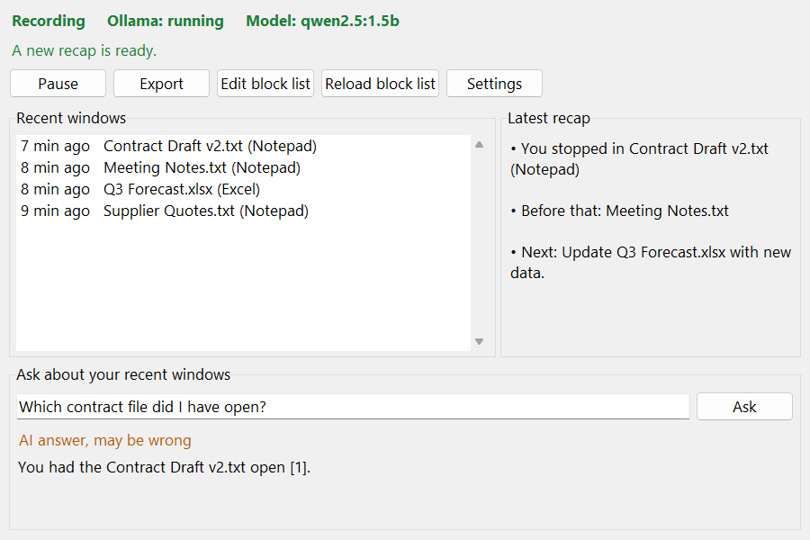
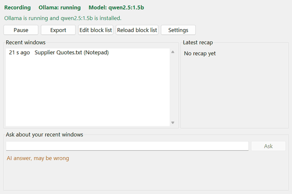
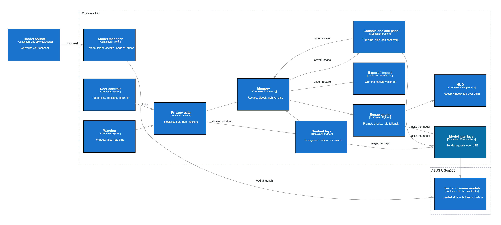
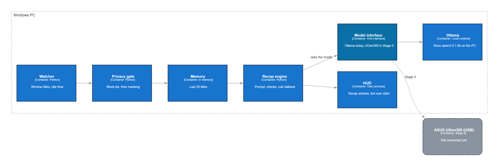

# Recall Plug

[](https://github.com/geoffreysugs/recallplug/actions/workflows/tests.yml)

**Your “where was I?”, prepared while you are away.**

Recall Plug is a small Windows app that answers one question the moment you sit back down: *what was I working on?* It keeps a short list of the windows you used (titles only, in memory). While you are away, a local language model prepares a three-line recap, and you can ask questions about your recent windows. Everything runs on your own PC.



- **Recent windows** — the last 25 window titles, after a block list and masking, in memory only
- **Recap** — three lines ready when you return, also shown at the bottom right of the screen
- **Ask** — “Which contract file did I have open?”; answers cite the windows they used
- **Pause** — Ctrl+Alt+P stops logging until you resume
- **Private** — titles and answers are never saved, except when you export on purpose



**Competition materials:** [slides](docs/competition/RecallPlug_Stage1_Presentation.pdf). The slides describe the competition plan, which targets the ASUS UGen300. This repository's current scope is the Windows app that runs with Ollama.

Entry for the **ASUS UGen AI League**: Battlefield Lightning · Workplace AI · Onsite track. The competition version is frozen at the tag `stage1-submitted`.

## Why

Interruptions are normal in office work, and getting back to the task takes time. In a field study of 24 information workers, interrupted work that was resumed on the same day took about 25 minutes to come back to, after more than two other activities [1].

Memory tools for the desktop exist, but they make a different trade-off. Windows Recall needs a Copilot+ PC (an NPU of 40+ TOPS) and takes images of your active screen every few seconds [2]. Screenpipe records the screen and audio continuously and stores them locally [3]. Recall Plug starts from the other end: it looks at the title of the window you are in, keeps only a short text list, and runs a **local model** on an ordinary Windows PC.

## Advantages

| Advantage | What it means |
|---|---|
| **Works offline** | After a one-time model download, no network is needed. |
| **No per-use token fees** | Every request runs on your own PC, so there is no cloud charge for each use, unlike cloud AI assistants. |
| **Private by design** | Only window titles are read, they stay in memory, and nothing is uploaded. |
| **Light on your PC** | A 1.5B model answers in a fraction of a second on a laptop GPU; the competition plan moves this work to a USB accelerator. |

## How it works

1. **Work.** Window titles are logged in memory (after a block list and masking).
2. **Idle.** No keyboard or mouse input for 5 minutes (10 seconds in demo mode).
3. **Recap.** A local model prepares three lines in the background.
4. **Return.** The recap appears in the window and at the bottom right of the screen, already written. The small recap window gets its text over standard input, so it never appears on a command line.

Real output of the current app:

```text
• You stopped in Contract Draft v2.txt (Notepad)
• You were drafting a contract.
• Next: Finish editing Contract Draft v2.txt.
```

**Facts by rules, reasoning by model.** Line 1 (where you stopped) is written by rules. Lines 2 and 3 (what you were doing, a next step) come from the model and are checked: they must be grounded in your recent windows, they must not suggest irreversible actions (delete, uninstall, send, pay, purchase, submit), and a line that fails a check is replaced by a rule-based sentence. A small model is good at themes and weak at counting windows, so each job sits where it works.

**Ask.** Questions like “which files did I open?”, “what was the last window?” or “how many windows?” are answered by rules from the list, without a model. Other questions go to the local model with only the numbered, masked title list. A model answer must cite at least one item number, otherwise it is replaced by “I don't know from the recent windows.”; questions that have nothing to do with your work get “I can only answer questions about your recent windows.” The window always shows “AI answer, may be wrong”.

## Architecture

**Competition plan:** light work stays on the PC; all AI models run on the UGen300. The models are stored on the PC and loaded into the device at each launch (the UGen300 datasheet lists 8 GB of memory and no storage). The only network use is a one-time model download, with your consent.



**This repository:** everything runs on the PC; the model interface talks to Ollama. The UGen300 is not connected.



All inference sits behind one interface (`OllamaBackend` and a mock backend for tests are built; the UGen300 backend is a stub that falls back to Ollama), so moving to a device should not change the rest of the program.

## Status

**Built**

- Window: status, recent windows, latest recap, ask box, export, block list editing, settings (`python -m app.gui`, or double-click `run.bat`)
- Window-title logging in memory only, idle detection, away and return detection
- Local recap: rules write line 1, the model writes lines 2–3 and is checked
- Ask about your recent windows: rule answers for list questions, checked model answers with item numbers
- Start-up self-check, with an optional model download through Ollama
- Pause hotkey (Ctrl+Alt+P) and export hotkey (Ctrl+Alt+E)
- Editable block list in `config/blocklist.txt`, reloaded without a restart; masking of emails, phone numbers and card numbers
- Export to a text file, only after a warning
- Settings: away time, demo mode, model name
- Recap window at the bottom right, fed over standard input
- Model interface with Ollama and a mock backend, plus a CPU-only option for measurements
- Command-line version (`python -m app.main`, `run_cli.bat`), benchmark script, vision evaluation tool
- 304 automated tests, run on GitHub Actions (Windows) on every push

**Future work (not built)**

- UGen300 backend with on-device measurements
- Reading window content with a vision model (the image deleted right after analysis)
- Pins with notes, 30-minute digest, 60-minute archive
- Encrypted saving
- Network audit

## Hardware and models

| Function | Model | Platform | Status |
|---|---|---|---|
| Recap and ask (text) | qwen2.5:1.5b via Ollama | Windows 11 laptop | Built |
| Recap and ask (text) | Qwen2.5-1.5B-Instruct | ASUS UGen300 (Hailo-10H) | Competition plan |
| Screen description (vision) | Qwen2.5-VL 3B via Ollama, stand-in model | Windows 11 laptop | Tested by hand |
| Screen description (vision) | Qwen2-VL-2B-Instruct | ASUS UGen300 (Hailo-10H) | Competition plan |

UGen300 datasheet: 40 TOPS (INT4) / 20 TOPS (INT8), 8 GB LPDDR4, 2.5 W typical, USB 3.1 Gen2 Type-C [4]. Model files are not part of this repository; at start the app checks Ollama and offers to download the model through it.

## Results

**MEASURED on a laptop** (30 runs per scenario, 2026-10-25, Intel i7-12650H, RTX 4060 Laptop, 64 GB RAM, Windows 11, Ollama, warm model, plugged in, fake English windows):

| Metric | office | web_heavy |
|---|---|---|
| Model call, median (p95) | 0.184 s (0.202) | 0.149 s (0.190) |
| Output speed, median | 180.7 tokens/s | 185.7 tokens/s |
| Host CPU, system-wide, median | 11.2% | 9.4% |
| Host RAM, system-wide | 19.5% | 19.5% |

**UGen300 datasheet (Hailo benchmark, not our measurement)** [4]:

| Model | Load | First token | Speed |
|---|---|---|---|
| Qwen2.5-1.5B (text) | 5.05 s | 0.37 s | 6.82 tokens/s |
| Qwen2-VL-2B (vision) | 6.23 s | 0.93 s (image) | 6.73 tokens/s |

The UGen300 outputs fewer tokens per second than this laptop's GPU. The recap is prepared before you return, so what matters is keeping the PC free.

**Vision check on five screens (MEASURED, 2026-10-26, one laptop, stand-in model Qwen2.5-VL 3B, GPU off):** one description took 84–93 s with whole-machine CPU at 64–68% on average. Checked by hand, all five descriptions were correct and added information the window titles did not contain; the model still copied some names. GPU mode printed garbled output on this machine and is not used. The screenshots and descriptions are kept outside this repository.

Notes: CPU and RAM are whole-computer averages during the call. The laptop has a discrete GPU, so the first table does not show what an accelerator saves. At a low temperature the outputs are near-identical across runs, so the check pass rate shows format compliance, not quality. Raw results are in `bench/results/`.

## Quick start

1. Install [Python 3.12](https://www.python.org/downloads/) (tick “Add python.exe to PATH”) and [Ollama](https://ollama.com/download).
2. Download the project: **Code > Download ZIP** on GitHub (then unzip), or `git clone https://github.com/geoffreysugs/recallplug.git`.
3. Double-click **run.bat** (or **run_demo.bat** for the 10-second demo). If the model is missing, the window offers to download it through Ollama (about 1 GB).

`pip install -r requirements.txt` is optional (`psutil`, for CPU and RAM numbers in measurements).

**Hotkeys:** Ctrl+Alt+P pause / resume · Ctrl+Alt+E export.

```text
python -m app.gui                        # the window (what run.bat starts)
python -m app.gui --demo                 # "away" shortened to 10 s (run_demo.bat)
python -m app.gui --backend mock         # ollama (default) | mock | hailo (stub that falls back to Ollama)
python -m app.gui --no-model             # rule-based lines only, no model call
python -m app.gui --model NAME           # another Ollama model
python -m app.gui --cpu-only             # ask Ollama not to use the GPU
python -m app.gui --blocklist PATH       # use another block list file (default config/blocklist.txt)

python -m app.main                       # command-line version (run_cli.bat), real timers
python -m app.main --preview 15          # log windows for 15 s, then show the recap now
python -m app.main --demo                # real flow, "away" shortened to 10 s
python -m app.main --preview 25 --debug  # also print the raw model answer and why a line was replaced (terminal only, never saved)
python -m app.main --yes                 # if the model is missing, download it through Ollama without asking
python -m app.hud --sample               # show the recap window with sample text

python -m bench.run_bench --runs 30      # benchmark both fake scenarios (office, web_heavy)
python -m bench.run_bench --runs 10 --cpu-only
python -m bench.run_bench --runs 10 --no-model
python -m tools.vision_eval              # vision model check on a folder of screenshots (results are written outside the repo)
python -B -m tools.live_smoke            # live check on this desktop: Ollama, recap window, hotkey, recap, ask

python -m unittest -v                    # run the 304 tests
```

`app.main` takes the same `--model`, `--backend`, `--no-model`, `--cpu-only` and `--blocklist` flags. Settings saved in the window (away minutes, demo mode, model name) apply at the next start; command-line flags win over them. More on the tools: [tools/README.md](tools/README.md).

## Privacy

What is written to disk:

| File | Contents | When |
|---|---|---|
| `exports/recallplug_YYYYMMDD_HHMMSS.txt` | Your recent window titles and the latest recap, **unencrypted** | Only when you press Export (or Ctrl+Alt+E) and confirm the warning |
| `config/settings.json` | Away minutes, demo mode, model name | When you save the Settings dialog |
| `config/blocklist.txt` | Your block-list keywords | Created from the built-in list if missing; you edit it |
| `logs/metrics.csv` | Timing numbers of model calls (no titles, no text) | After each recap that used the model |
| `bench/results/` | Benchmark numbers for fake windows | Only when you run the benchmark |
| `bench/net_audit/` | Connection counts and addresses | Only when you run the network audit tool |

What is never written to disk: window titles, recaps, model answers, your questions and the answers to them (apart from the export above). The app talks only to Ollama on 127.0.0.1; when you choose to download a model, Ollama downloads it. `exports/`, `logs/` and `config/settings.json` are excluded from git.

## Limitations

- Windows only.
- Tested with English windows only, on one laptop.
- A 1.5B model gives modest answers and can be wrong; check what it says. When recent windows are web pages, it tends to continue the main document rather than the last page.
- Ask sees window titles only, never what is inside a file.
- The UGen300 was never tested; its numbers come from the datasheet.
- Vision descriptions (tested by hand only) can misread and still copy some names.

## References

1. Mark, G., Gonzalez, V. M., Harris, J. “No Task Left Behind? Examining the Nature of Fragmented Work.” CHI 2005, pp. 321–330.
2. Microsoft. Copilot+ PCs. https://www.microsoft.com/en-gb/windows/copilot-plus-pcs
3. Screenpipe. “What is screenpipe?” https://screenpi.pe/about
4. ASUS. UGen300 USB AI Accelerator datasheet (UGen300-USB-8G); benchmark figures from Hailo.

## About

Built by 蘇靖飛 (GitHub: geoffreysugs) for the ASUS UGen AI League. MIT License, see [LICENSE](LICENSE).

Built with AI assistance (Claude and Claude Code).
