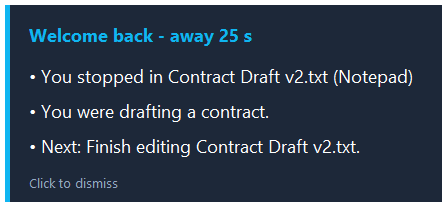
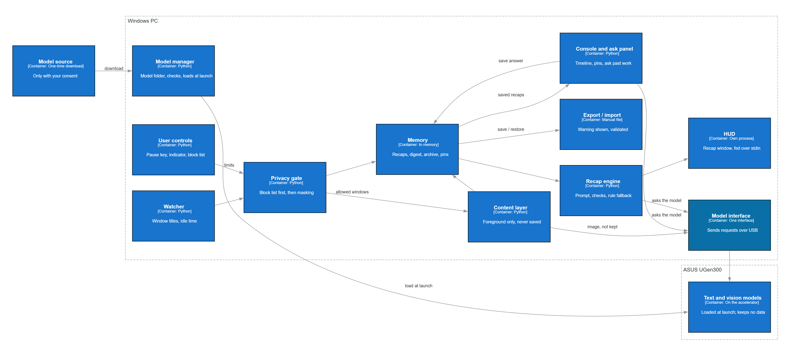

# RecallPlug

**Your “where was I?”, prepared while you are away.**

RecallPlug is a small Windows tool that answers one question the moment you sit back down: *what was I working on?* While you are away from your desk, a local language model prepares a three-line recap. When you return, it appears in a translucent window at the bottom right of the screen.



Entry for the **ASUS UGen AI League**: Battlefield Lightning · Workplace AI · Onsite track. Target hardware: **ASUS UGen300 USB AI Accelerator** (Hailo-10H). The prototype runs on a laptop with Ollama today; the UGen300 backend is planned for Stage II.

## Why

Interruptions are normal in office work, and getting back to the task takes time. In a field study of 36 workers, resuming an interrupted task took about 25 minutes on average, including time spent on other work [1].

Memory tools for the desktop exist, but they make a different trade-off. Windows Recall needs a Copilot+ PC (an NPU of 40+ TOPS, 16 GB RAM, 256 GB storage) and takes screen snapshots every few seconds [2]. RecallPlug starts from the other end: the current prototype uses **window titles only**, keeps them **in memory**, and runs a **local model** on an ordinary Windows PC.

## How it works

1. **Work.** Window titles are logged in memory (after a block list and masking).
2. **Idle.** No keyboard or mouse input for 5 minutes (10 seconds in demo mode).
3. **Recap.** A local model prepares three lines in the background.
4. **Return.** The recap appears at the bottom right, already written. It is handed to the recap window over standard input, so it never appears on a command line.

Real output of the current prototype:

```text
• You stopped in Contract Draft v2.txt (Notepad)
• You were drafting a contract.
• Next: Finish editing Contract Draft v2.txt.
```

**Facts by rules, reasoning by model.** Line 1 (where you stopped) is rule-based, so it is always correct. Lines 2 and 3 (what you were doing, a next step) come from the model and are checked: they must be grounded in your recent windows, they must not suggest irreversible actions (delete, uninstall, send, pay, purchase, submit), and a line that fails a check is replaced by a rule-based sentence. A small model is good at themes and weak at counting windows, so each job sits where it works.

## Privacy

- Only window titles are used. No screenshots, no screen text.
- Titles stay in memory. They are never written to disk, and neither are the model's answers.
- Windows whose titles suggest banking, passwords or private browsing are skipped. Email addresses, phone numbers, card numbers and ID numbers are masked before text reaches the model.
- Inference runs locally; no cloud service is part of the pipeline, by design. A network audit is planned for Stage II.

## Architecture



*Target architecture.* Light work stays on the PC: watching window titles, privacy checks, memory, the recap engine and the recap window. All AI models are planned to run on the ASUS UGen300 behind one model interface. Content-layer images are never kept; only text goes to memory.

**Today (Stage I)** everything runs on the laptop: the model interface talks to Ollama on the PC. The content layer, export and import, and the UGen300 backend are planned for Stage II.


## Hardware and models

| Function | Model | Platform | Status |
|---|---|---|---|
| Away recap (text) | qwen2.5:1.5b via Ollama | Windows 11 laptop | Built |
| Away recap (text) | Qwen2.5-1.5B-Instruct | ASUS UGen300 (Hailo-10H) | Planned |
| Screen description (vision) | Qwen2.5-VL 3B via Ollama, stand-in model | Windows 11 laptop | Tested manually |
| Screen description (vision) | Qwen2-VL-2B-Instruct | ASUS UGen300 (Hailo-10H) | Planned |

UGen300 datasheet: 40 TOPS (INT4) / 20 TOPS (INT8), 8 GB LPDDR4, 2.5 W typical, USB 3.1 Gen2 Type-C [3].

## Results

**MEASURED on a laptop** (30 runs per scenario, 2026-10-25, Intel i7-12650H, RTX 4060 Laptop, 64 GB RAM, Windows 11, Ollama, warm model, plugged in, fake English windows):

| Metric | office | web_heavy |
|---|---|---|
| Model call, median (p95) | 0.184 s (0.202) | 0.149 s (0.190) |
| Output speed, median | 180.7 tokens/s | 185.7 tokens/s |
| Host CPU, system-wide, median | 11.2% | 9.4% |
| Host RAM, system-wide | 19.5% | 19.5% |

**PROJECTED for UGen300** from the datasheet benchmarks [3]: about 4.0 s for a 25-token text recap and about 8.4 s for a 50-token vision description (the 50 tokens is an assumption). These are estimates, not measurements.

**Vision check on five screens (MEASURED, CPU only, 2026-10-26, one laptop, stand-in model):** one description took 84–93 s with whole-machine CPU at 64–68% on average. By hand, all five descriptions were correct and added information the window titles did not contain; the model still copied some names. GPU mode printed garbled output on this machine and is not used. The screenshots and descriptions are kept outside this repository.

Notes: CPU and RAM are whole-computer averages during the call. The laptop has a discrete GPU, so the first table does not show the value of an accelerator. Raw results are in `bench/results/`.

## Status

- [x] Window-title logging (memory only), idle detection, recap window fed over standard input
- [x] Local recap: rule-based line 1, checked lines 2 and 3
- [x] Privacy masking and block list for titles
- [x] Inference backend interface (Ollama, mock) and a CPU-only option
- [x] Benchmark script, vision evaluation tool, and 168 automated tests
- [ ] Planned for Stage II: UGen300 backend with on-device numbers, content layer (a text description of the foreground window when you leave, image never kept), network audit, export and import of the memory

## Quick start

Requirements: Windows 11, Python 3.12 and [Ollama](https://ollama.com) running locally with the model pulled (`ollama pull qwen2.5:1.5b`). `pip install -r requirements.txt` is optional (`psutil`, for CPU and RAM numbers).

```text
python -m app.main                       # run with real timers (away after 5 min idle)
python -m app.main --preview 15          # log windows for 15 s, then show the recap now
python -m app.main --demo                # real flow, "away" shortened to 10 s
python -m app.main --preview 25 --debug  # also print the raw model answer and why a line was replaced (terminal only, never saved)
python -m app.main --backend mock        # ollama (default) | mock | hailo (Stage II stub)
python -m app.main --no-model            # rule-based lines only, no model call
python -m app.main --cpu-only            # ask Ollama not to use the GPU
python -m app.hud --sample               # show the recap window with sample text

python -m bench.run_bench --runs 30      # benchmark both fake scenarios (office, web_heavy)
python -m bench.run_bench --runs 10 --cpu-only
python -m bench.run_bench --runs 10 --no-model
python -m tools.vision_eval              # vision model check on a folder of screenshots (results are written outside the repo)

python -m unittest -v                    # run the tests
```

Benchmark results are saved to `bench/results/<timestamp>/` (`results.csv`, `summary.md`); `bench/summary.md` is the latest summary. No window titles or model answers are written to any file.

## Limitations

- A 1.5B model gives modest next-step suggestions. When recent windows are web pages, it tends to continue the main document rather than the last page.
- The current prototype uses window titles only, so vague titles give vague recaps.
- Tested on one laptop, mostly with fake English windows; non-English titles and other screen setups are untested.
- The UGen300 backend is not implemented yet.

## Roadmap

- **Stage I (by 2026-10-28):** prototype, tests, benchmark, vision check, public repository.
- **2026-11-06 to 12-04 (Stage II):** UGen300 backend and on-device benchmark, content layer, network audit, export and import.
- **2026-12-10 / 12-19:** final deck, then the final at ASUS HQ.

## References

1. Mark, Gonzalez, Harris. “No Task Left Behind? Examining the Nature of Fragmented Work.” CHI 2005.
2. Microsoft. Copilot+ PCs and Recall requirements. https://microsoft.com/en-ie/windows/copilot-plus-pcs
3. [Datasheet] UGen300-USB-8G 1

## About

Built by 蘇靖飛 (GitHub: geoffreysugs) for the ASUS UGen AI League.
