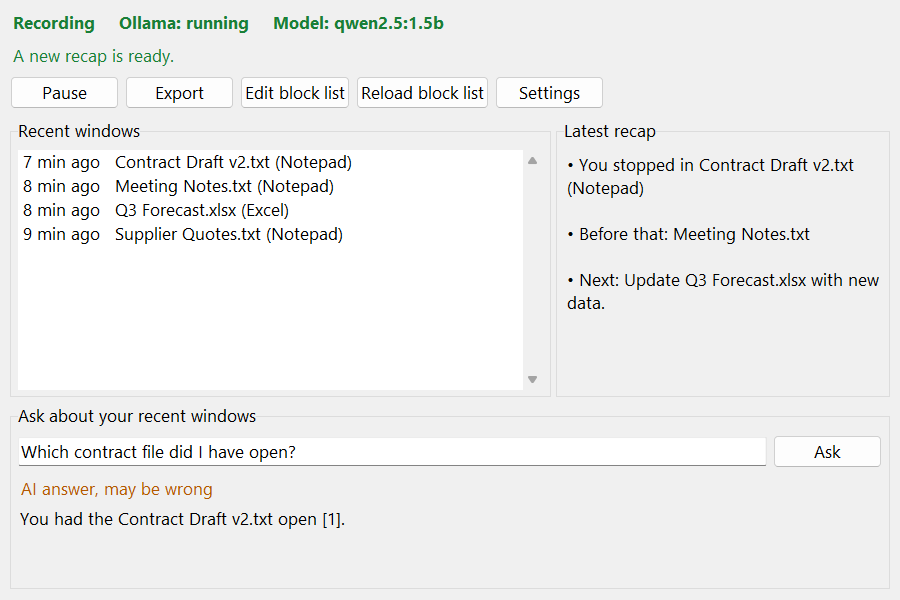
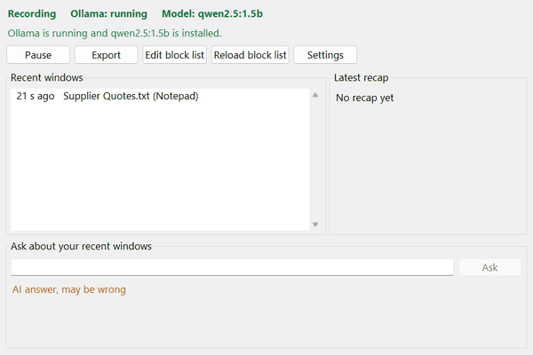
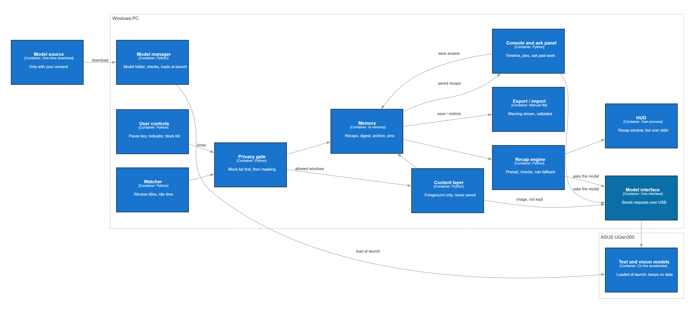
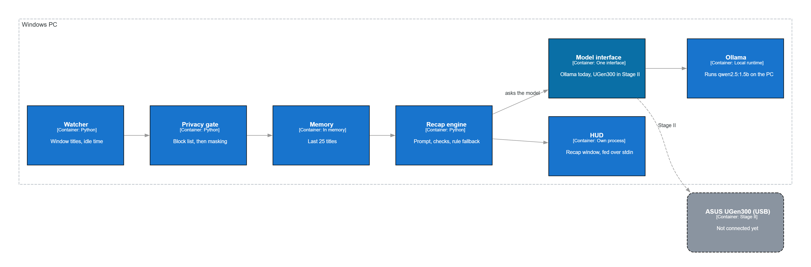

[English](README.md) | 繁體中文
# Recall Plug

[](https://github.com/geoffreysugs/recallplug/actions/workflows/tests.yml)

**你的「我剛剛做到哪裡？」，在你離開時就準備好。**

Recall Plug 是一個小型的 Windows 程式，在你坐回電腦前的那一刻回答一個問題：*我剛剛在做什麼？* 它會保留一份你用過的視窗簡短清單（只有標題，只存在記憶體中）。你離開時，本機的語言模型會準備三行摘要，你也可以針對最近的視窗提問。所有處理都在你自己的電腦上執行。



- **最近視窗** — 最近 25 個視窗標題，經過封鎖清單過濾與遮蔽，只存在記憶體中
- **摘要** — 你回來時三行摘要已經準備好，也會顯示在螢幕右下角
- **提問** — 例如 “Which contract file did I have open?”（我剛剛開著哪個合約檔？）；回答會標出它用到的視窗
- **暫停** — Ctrl+Alt+P 停止記錄，直到你恢復
- **隱私** — 標題和回答一律不存檔，除非你主動匯出



**競賽資料：** [簡報](docs/competition/RecallPlug_Stage1_Presentation.pdf)。簡報說明的是競賽計畫，目標硬體是 ASUS UGen300。本 repository（程式碼庫）目前的範圍是搭配 Ollama 執行的 Windows 程式。

參加 **ASUS UGen AI League** 的作品：Battlefield Lightning · Workplace AI · Onsite track。競賽版本固定在標籤 `stage1-submitted`。

## 為什麼

在辦公室工作中，被打斷是常態，而回到原本的工作需要時間。一項針對 24 位資訊工作者的實地研究發現，被打斷後在同一天恢復的工作，約 25 分鐘後才回到原工作，而且中間會先經過超過兩件的其他活動 [1]。

桌面用的記憶工具已經存在，但它們做的是不同的取捨。Windows Recall 需要 Copilot+ PC（NPU（神經網路處理器）達 40+ TOPS（每秒兆次運算）），並且每隔幾秒擷取一次你目前螢幕的畫面 [2]。Screenpipe 會持續錄下螢幕和聲音，並存放在本機 [3]。Recall Plug 從另一端出發：它只看你目前所在視窗的標題，只保留一份簡短的文字清單，並在一般的 Windows 電腦上執行**本機模型**。

## 優點

| 優點 | 代表什麼 |
|---|---|
| **離線可用** | 模型只需下載一次，之後不需要網路。 |
| **沒有按次計費的 token（詞元）費用** | 每個請求都在你自己的電腦上執行，所以不像雲端 AI 助理那樣，每次使用都有雲端費用。 |
| **設計上就重視隱私** | 只讀取視窗標題，標題留在記憶體中，不會上傳任何東西。 |
| **對電腦負擔小** | 1.5B 模型在筆電 GPU（顯示卡）上不到一秒就能回答；競賽計畫會把這部分工作移到 USB 加速器上。 |

## 運作方式

1. **工作。** 視窗標題記錄在記憶體中（經過封鎖清單過濾與遮蔽）。
2. **閒置。** 5 分鐘沒有鍵盤或滑鼠輸入（示範模式為 10 秒）。
3. **摘要。** 本機模型在背景準備三行摘要。
4. **回來。** 摘要已經寫好，會出現在程式視窗中，也會出現在螢幕右下角。小型摘要視窗透過標準輸入取得文字，所以文字不會出現在命令列上。

目前程式的實際輸出：

```text
• You stopped in Contract Draft v2.txt (Notepad)
• You were drafting a contract.
• Next: Finish editing Contract Draft v2.txt.
```

**事實交給規則，推理交給模型。** 第 1 行（你停在哪裡）由規則寫出。第 2、3 行（你在做什麼、下一步）來自模型，並且會經過檢查：內容必須以你最近的視窗為根據，不得建議無法復原的動作（刪除、解除安裝、傳送、付款、購買、送出），未通過檢查的行會換成規則產生的句子。小模型擅長歸納主題，但不擅長數視窗，所以每項工作都交給做得好的一方。

**提問。** 像 “which files did I open?”（我開過哪些檔案？）、“what was the last window?”（最後一個視窗是什麼？）或 “how many windows?”（有幾個視窗？）這類問題，由規則直接從清單回答，不使用模型。其他問題會交給本機模型，而且只給它編了號、經過遮蔽的標題清單。模型的回答必須標出至少一個項目編號，否則會換成 “I don't know from the recent windows.”（從最近的視窗看不出來。）；與你的工作無關的問題會得到 “I can only answer questions about your recent windows.”（我只能回答關於你最近視窗的問題。）。視窗中一律顯示 “AI answer, may be wrong”（AI 回答，可能有誤）。

## 架構

**競賽計畫：** 輕量工作留在電腦上；所有 AI 模型都在 UGen300 上執行。模型存放在電腦上，每次啟動時載入裝置（UGen300 規格書列出 8 GB 記憶體，沒有儲存空間）。唯一的網路使用是一次性的模型下載，而且需經你同意。



**本 repository：** 所有處理都在電腦上執行；模型介面與 Ollama 溝通。UGen300 沒有接上。



所有推論都放在同一個介面後面（`OllamaBackend` 和測試用的 mock（模擬）後端已經完成；UGen300 後端是 stub（佔位實作），會改用 Ollama），所以換到裝置上執行時，程式的其他部分應該不需要更動。

## 目前狀態

**已完成**

- 視窗：狀態、最近視窗、最新摘要、提問框、匯出、封鎖清單編輯、設定（`python -m app.gui`，或雙擊 `run.bat`）
- 只在記憶體中記錄視窗標題、閒置偵測、離開與回來的偵測
- 本機摘要：規則寫第 1 行，模型寫第 2–3 行並經過檢查
- 針對最近的視窗提問：清單類問題由規則回答，模型的回答會附項目編號並經過檢查
- 啟動自我檢查，可選擇透過 Ollama 下載模型
- 暫停熱鍵（Ctrl+Alt+P）和匯出熱鍵（Ctrl+Alt+E）
- 可編輯的封鎖清單 `config/blocklist.txt`，不需重新啟動就會重新載入；遮蔽電子郵件、電話號碼和卡號
- 匯出成文字檔，只在顯示警告之後
- 設定：離開時間、示範模式、模型名稱
- 右下角的摘要視窗，透過標準輸入取得內容
- 支援 Ollama 和 mock 後端的模型介面，另有只用 CPU 的選項供量測使用
- 命令列版本（`python -m app.main`、`run_cli.bat`）、benchmark（基準測試）腳本、視覺評估工具
- 304 個自動化測試，每次 push 都在 GitHub Actions（Windows）上執行

**未來工作（尚未實作）**

- UGen300 後端，以及在裝置上的量測
- 用視覺模型讀取視窗內容（圖片在分析後立即刪除）
- 附註記的釘選、30 分鐘彙整、60 分鐘封存
- 加密儲存
- 網路稽核

## 硬體與模型

| 功能 | 模型 | 平台 | 狀態 |
|---|---|---|---|
| 摘要與提問（文字） | qwen2.5:1.5b，透過 Ollama | Windows 11 筆電 | 已完成 |
| 摘要與提問（文字） | Qwen2.5-1.5B-Instruct | ASUS UGen300 (Hailo-10H) | 競賽計畫 |
| 螢幕描述（視覺） | Qwen2.5-VL 3B，透過 Ollama，替代模型 | Windows 11 筆電 | 人工測試 |
| 螢幕描述（視覺） | Qwen2-VL-2B-Instruct | ASUS UGen300 (Hailo-10H) | 競賽計畫 |

UGen300 規格書：40 TOPS (INT4) / 20 TOPS (INT8)、8 GB LPDDR4、典型功耗 2.5 W、USB 3.1 Gen2 Type-C [4]。模型檔不包含在本 repository 中；程式啟動時會檢查 Ollama，並提供透過 Ollama 下載模型的選項。

## 測試結果

**筆電上實測**（每個情境 30 次，2026-10-25，Intel i7-12650H、RTX 4060 Laptop、64 GB RAM、Windows 11、Ollama、模型已預先載入、接上電源、虛構的英文視窗）：

| 指標 | office | web_heavy |
|---|---|---|
| 模型呼叫，中位數（p95） | 0.184 s (0.202) | 0.149 s (0.190) |
| 輸出速度，中位數 | 180.7 tokens/s | 185.7 tokens/s |
| 主機 CPU，全系統，中位數 | 11.2% | 9.4% |
| 主機 RAM，全系統 | 19.5% | 19.5% |

**UGen300 規格書（Hailo 的 benchmark，不是我們的量測）** [4]：

| 模型 | 載入 | 第一個 token | 速度 |
|---|---|---|---|
| Qwen2.5-1.5B（文字） | 5.05 s | 0.37 s | 6.82 tokens/s |
| Qwen2-VL-2B（視覺） | 6.23 s | 0.93 s（圖片） | 6.73 tokens/s |

UGen300 每秒輸出的 token 比這台筆電的 GPU 少。摘要在你回來之前就已準備好，所以重點在於讓電腦保持空閒。

**五個畫面的視覺檢查（實測，2026-10-26，一台筆電，替代模型 Qwen2.5-VL 3B，未使用 GPU）：** 每則描述花 84–93 s，整台電腦的 CPU 平均使用率為 64–68%。經人工檢查，五則描述全部正確，並補充了視窗標題中沒有的資訊；不過模型仍會照抄部分名稱。GPU 模式在這台電腦上輸出亂碼，因此不採用。截圖和描述存放在本 repository 之外。

附註：CPU 和 RAM 是模型呼叫期間整台電腦的平均值。這台筆電有獨立顯示卡，所以第一張表看不出加速器能省下多少。在低 temperature（溫度參數）下，每次執行的輸出幾乎相同，所以檢查通過率反映的是格式符合度，而不是品質。原始結果在 `bench/results/`。

## 快速開始

1. 安裝 [Python 3.12](https://www.python.org/downloads/)（勾選 “Add python.exe to PATH”）和 [Ollama](https://ollama.com/download)。
2. 下載專案：在 GitHub 上按 **Code > Download ZIP**（然後解壓縮），或執行 `git clone https://github.com/geoffreysugs/recallplug.git`。
3. 雙擊 **run.bat**（或雙擊 **run_demo.bat** 使用 10 秒示範）。如果缺少模型，視窗會提供透過 Ollama 下載的選項（約 1 GB）。

`pip install -r requirements.txt` 是選用的（`psutil`，用於量測時的 CPU 和 RAM 數據）。

**熱鍵：** Ctrl+Alt+P 暫停／恢復 · Ctrl+Alt+E 匯出。

```text
python -m app.gui                        # 程式視窗（run.bat 啟動的就是這個）
python -m app.gui --demo                 # 「離開」縮短為 10 s（run_demo.bat）
python -m app.gui --backend mock         # ollama（預設）| mock | hailo（stub，會改用 Ollama）
python -m app.gui --no-model             # 只用規則產生的行，不呼叫模型
python -m app.gui --model NAME           # 使用另一個 Ollama 模型
python -m app.gui --cpu-only             # 要求 Ollama 不使用 GPU
python -m app.gui --blocklist PATH       # 使用另一個封鎖清單檔（預設 config/blocklist.txt）

python -m app.main                       # 命令列版本（run_cli.bat），使用真實計時
python -m app.main --preview 15          # 記錄視窗 15 s，然後立刻顯示摘要
python -m app.main --demo                # 真實流程，「離開」縮短為 10 s
python -m app.main --preview 25 --debug  # 另外印出模型原始回答，以及某行被替換的原因（只顯示在終端機，一律不存檔）
python -m app.main --yes                 # 如果缺少模型，不詢問直接透過 Ollama 下載
python -m app.hud --sample               # 用範例文字顯示摘要視窗

python -m bench.run_bench --runs 30      # 對兩個虛構情境做 benchmark（office、web_heavy）
python -m bench.run_bench --runs 10 --cpu-only
python -m bench.run_bench --runs 10 --no-model
python -m tools.vision_eval              # 對一個截圖資料夾做視覺模型檢查（結果寫在 repo 之外）
python -B -m tools.live_smoke            # 在這台桌面上實際檢查：Ollama、摘要視窗、熱鍵、摘要、提問

python -m unittest -v                    # 執行 304 個測試
```

`app.main` 接受相同的 `--model`、`--backend`、`--no-model`、`--cpu-only` 和 `--blocklist` 參數。在視窗中儲存的設定（離開分鐘數、示範模式、模型名稱）會在下次啟動時套用；命令列參數優先於這些設定。工具的更多說明：[tools/README.md](tools/README.md)。

## 隱私

會寫入磁碟的內容：

| 檔案 | 內容 | 時機 |
|---|---|---|
| `exports/recallplug_YYYYMMDD_HHMMSS.txt` | 你最近的視窗標題和最新摘要，**未加密** | 只在你按下 Export（或 Ctrl+Alt+E）並確認警告時 |
| `config/settings.json` | 離開分鐘數、示範模式、模型名稱 | 在你儲存設定對話框時 |
| `config/blocklist.txt` | 你的封鎖清單關鍵字 | 檔案不存在時由內建清單建立；由你編輯 |
| `logs/metrics.csv` | 模型呼叫的時間數據（不含標題、不含文字） | 每次使用模型產生摘要之後 |
| `bench/results/` | 虛構視窗的 benchmark 數據 | 只在你執行 benchmark 時 |
| `bench/net_audit/` | 連線次數和位址 | 只在你執行網路稽核工具時 |

一律不會寫入磁碟的內容：視窗標題、摘要、模型回答、你的問題以及對它們的回答（上述匯出除外）。程式只和 127.0.0.1 上的 Ollama 溝通；當你選擇下載模型時，是由 Ollama 下載。`exports/`、`logs/` 和 `config/settings.json` 不納入 git。

## 限制

- 只支援 Windows。
- 只用英文視窗測試過，而且只在一台筆電上。
- 1.5B 模型的回答品質普通，可能會出錯；請自行核對它說的內容。當最近的視窗是網頁時，它傾向於延續主要文件，而不是最後一個網頁。
- 提問功能只看得到視窗標題，看不到檔案內的內容。
- UGen300 從未實測過；它的數據來自規格書。
- 視覺描述（只經過人工測試）可能判讀錯誤，而且仍會照抄部分名稱。

## 參考資料

1. Mark, G., Gonzalez, V. M., Harris, J. “No Task Left Behind? Examining the Nature of Fragmented Work.” CHI 2005, pp. 321–330.
2. Microsoft. Copilot+ PCs. https://www.microsoft.com/en-gb/windows/copilot-plus-pcs
3. Screenpipe. “What is screenpipe?” https://screenpi.pe/about
4. ASUS. UGen300 USB AI Accelerator 規格書（UGen300-USB-8G）；benchmark 數據來自 Hailo。

## 關於

由 蘇靖飛（GitHub: geoffreysugs）為 ASUS UGen AI League 製作。MIT 授權，詳見 [LICENSE](LICENSE)。

本專案在 AI 協助下完成（Claude 與 Claude Code）。
